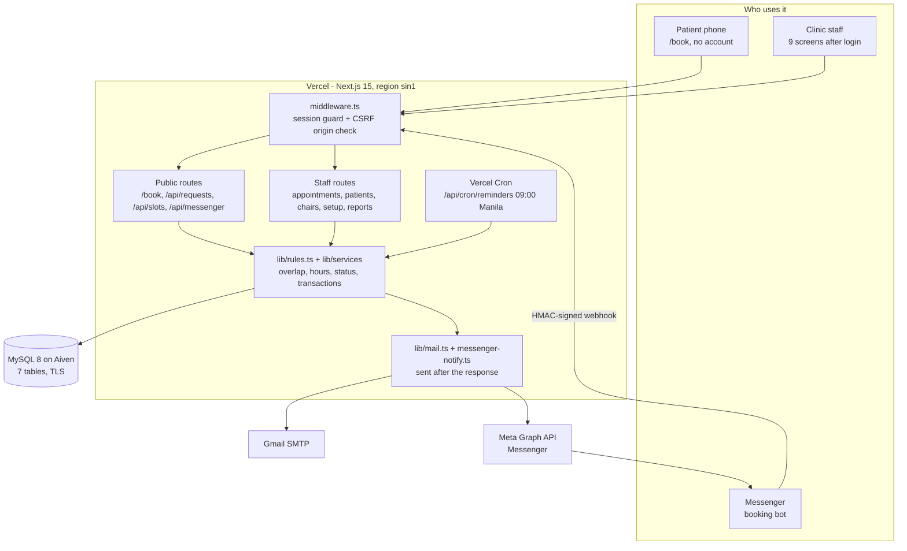
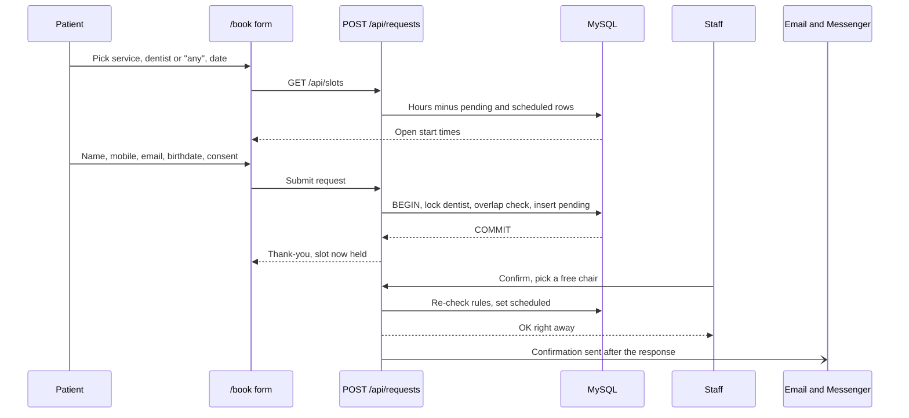
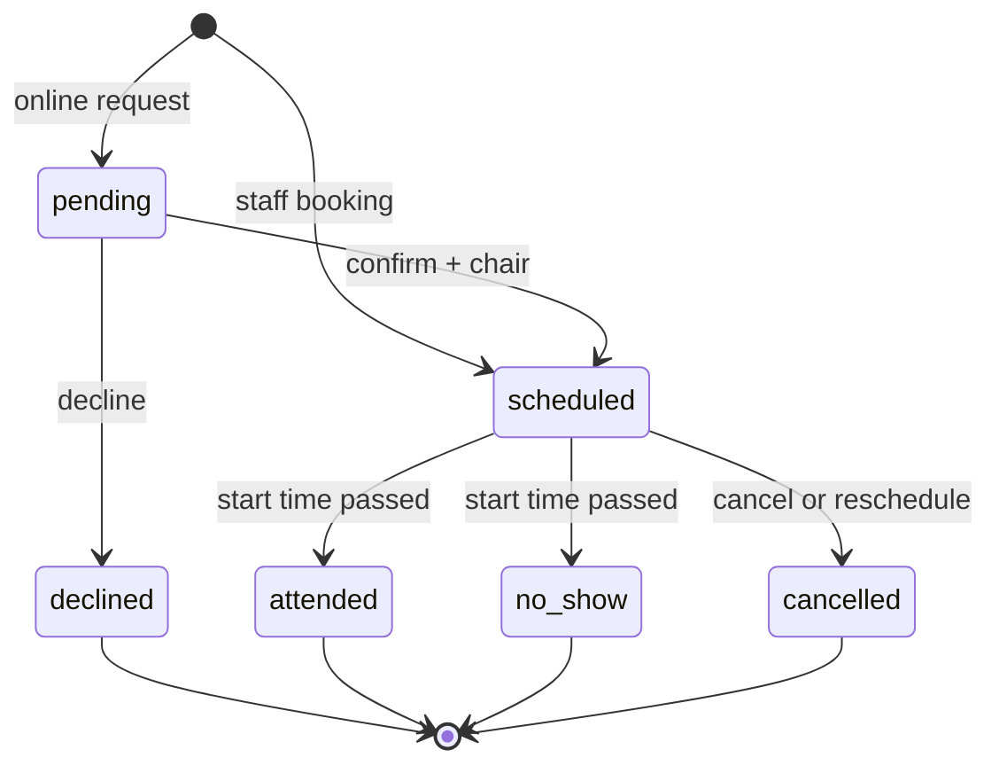
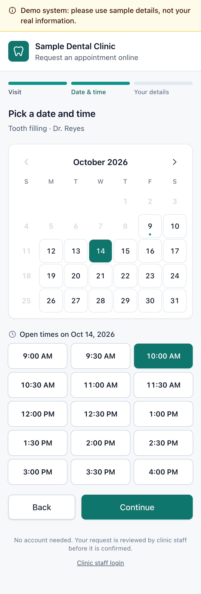
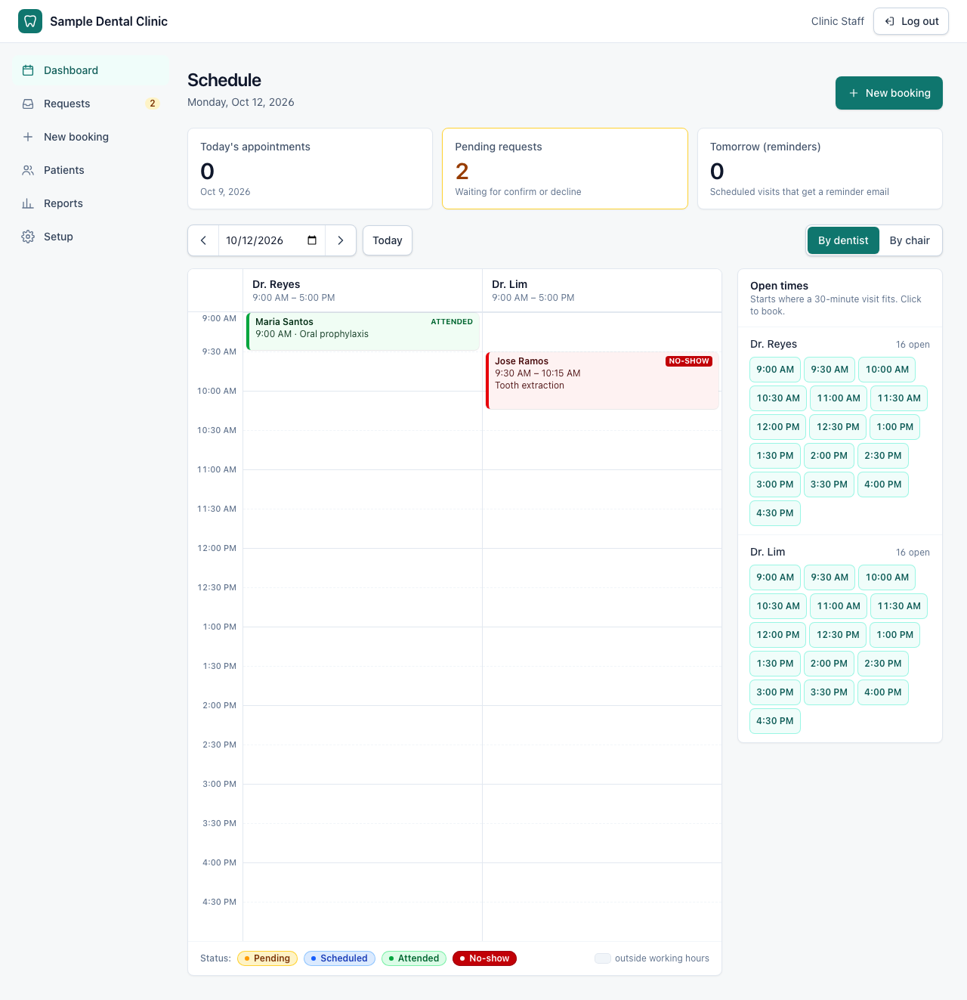
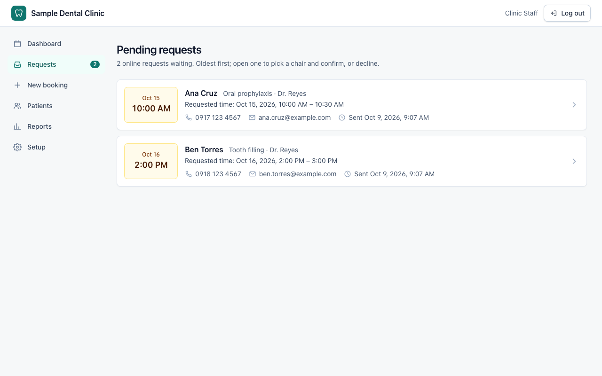

# Molar & Co.

<p align="center">
  
</p>

<p align="center">
  
  
  
  
  
</p>

<p align="center">
  
  
  
  
  
  
  
  
  
</p>

> **Appointment scheduling and attendance tracking for a small dental clinic** — patients request a slot online with no account, staff run the day from one screen.

**Live app:** https://molarandco.vercel.app

**Jump to:** [Architecture](#system-architecture) · [Feature set](#current-feature-set) · [Business rules](#business-rules) · [Tech stack](#tech-stack) · [Project map](#project-map) · [Run locally](#run-locally) · [Testing](#testing) · [Deploy](#deploy) · [Docs](#docs)

Molar & Co. replaces a paper logbook and chat threads with one web system. Patients pick a service, dentist and time on their phone; staff confirm or decline, encode phone, chat and walk-in bookings, see every dentist's and chair's day, keep one record per patient, and read attendance and no-show reports. Confirmation and day-before reminder emails go out on their own, and an optional Messenger bot books through chat.

**Sample data only. Never enter real patient information.**

## Team

**Group Name:** Group 2, BSCS Information Management, Pamantasan ng Lungsod ng Maynila

| Member | Role |
| --- | --- |
| Ethan Dreiz Baltazar | Full Stack + Project Manager |

## Problem

A small clinic books by phone, Messenger and walk-in. Slots get double-booked, patients forget and don't show, and nobody can say how often a patient no-shows without counting pages. Patient history lives in notebooks, and an online form that needs an account never gets used.

## Solution

One scheduling core that every channel goes through. A request from the web form, a Messenger chat, or the front desk is checked by the same rules (working hours, no overlap for the dentist or chair, not in the past) inside a database transaction, so two people can never take the same slot. Open slots are computed on request from working hours and existing bookings, and never stored. Attendance totals and no-show counts are computed from recorded appointments too, so a report always matches the records.

## Patient and Staff Promise

- **Patients need no account.** `/book` works on a 360 px phone, asks for consent under the Data Privacy Act, and holds the slot the moment the request is sent.
- **Nothing is double-booked.** The overlap check and the write run in one transaction with the dentist (and chair) row locked.
- **A mail or chat failure never undoes a booking.** Notices are sent after the change is committed and after the response, so a slow mail server cannot stall the front desk.
- **One record per patient.** Online requests match an existing patient by Philippine mobile number, normalized to `09XXXXXXXXX`.
- **Staff data stays behind login.** Everything except the booking form, the slot lookup and the Messenger webhook needs a signed session.

## System Architecture



### Booking an online request



### Appointment status



### Data model

Seven tables, taken as-is from the paper's Listing 3.2 (plus one nullable `patients.messenger_psid` column and extra indexes).

| Table | Holds |
| --- | --- |
| `users` | Staff login, bcrypt hash |
| `patients` | One row per person, unique mobile number, optional Messenger id |
| `dentists` | Dentist names |
| `dentist_schedules` | Working days and hours per dentist |
| `services` | Service name and `duration_minutes` |
| `chairs` | Treatment chairs |
| `appointments` | Patient, dentist, service, chair, date, start and end, status, channel, notes, links for reschedules and follow-ups |

## How It Works

1. **Request.** A patient opens `/book`, picks a service and a dentist (or "any available"), sees only the real open slots, and submits. The request is saved as `pending` and the slot is held.
2. **Confirm or decline.** Staff open `/requests`. Confirming picks one of the chairs free at that time and emails the patient. Declining frees the slot at once and tells the patient.
3. **Walk-ins and calls.** Staff book phone, chat and walk-in visits from `/appointments/new`, searching for an existing patient first.
4. **Run the day.** The dashboard reads the database on every load and shows each dentist's and chair's day. After the start time, staff mark a visit `attended` or `no-show`.
5. **Reschedule.** The old row becomes `cancelled`, a new `scheduled` row links back to it, and the patient is told the new time.
6. **Remind.** Each morning at 09:00 Manila time a cron job emails every patient with a `scheduled` visit tomorrow, once.
7. **Report.** Reports count attendance by month, dentist and service, and list patients whose no-shows reach a threshold staff can set.

## Current Feature Set

### Patient side

- Public request form with service, dentist or "any available", date, time slot, name, mobile, email, birthdate, optional note and consent. Inline errors, Back and Change keep the choice.
- Mobile numbers take digits only (`+63` plus ten digits starting with 9); names reject digits.
- Honeypot field and abuse caps per contact number, per IP, and clinic-wide per hour and per day.
- Confirmation and decline emails; a day-before reminder email.

### Staff side

- Login with a hashed password and an 8-hour signed session cookie; failed-login throttling per IP and per email.
- **Requests:** confirm with a free chair, or decline.
- **Dashboard:** each dentist's and chair's day, open times link straight into the booking form.
- **Appointments:** book, reschedule, cancel, mark attended or no-show, add a dentist note per visit, create a follow-up visit.
- **Patients:** search by name or number, edit details, see full visit history.
- **Reports:** attendance and no-show rate per month, dentist and service; no-show watch list.
- **Setup:** dentists with working hours, services with durations, chairs. A row in use cannot be deleted and says why.

### Messenger booking bot (optional)

- Stateless quick-reply flow: service, dentist, day, time, then a summary with Confirm, Change something, or Start over.
- Ends in a signed, single-use, two-hour link to `/book` with the choices prefilled; the booking is recorded as channel `chat`.
- Confirmations, reminders and staff changes can also reach the patient on Messenger. Email stays the main channel.
- Webhook verifies Meta's HMAC signature and stays off until the three `MESSENGER_*` variables are set.

### Notices

- Confirm, decline, staff cancel and reschedule tell the patient by email, and by Messenger when linked.
- Sent after the database commit and after the response; failures are logged and never undo the change.

### Security and integrity

- Foreign keys, `UNIQUE`, `CHECK` and `ENUM` constraints back the application rules (NF02).
- CSRF origin check, security headers, `Cache-Control: private, no-store` on `/api/*`, request body cap, TLS to the database with CA verification.
- Secrets live only in environment variables.
- See [docs/SECURITY-REVIEW.md](docs/SECURITY-REVIEW.md) for findings and fixes.

## Business Rules

Every route uses the same checks from `lib/rules.ts`.

| Rule | In short |
| --- | --- |
| Overlap | Same date and same dentist or same chair, `new_start < old_end AND new_end > old_start`. Only `pending` and `scheduled` count. Back-to-back is fine. |
| Working hours | Start and end inside that weekday's schedule; no row means the dentist is off. |
| Not in the past | Date and start must be later than now in Manila time. |
| End time | `start_time + duration_minutes`, stored on save. |
| Open slots | Stepped every `SLOT_INTERVAL_MINUTES`, computed on request, never stored. |
| Status | `pending` to `scheduled` or `declined`; `scheduled` to `attended`, `cancelled` or `no-show`. The last four are final. |
| Race safety | Overlap check and write in one transaction, dentist row locked first. |
| Any available | Dentists tried in id order; the first that passes wins. |
| Reminder | Tomorrow (Manila), `scheduled`, not yet reminded, patient has an email. Re-running sends nothing new. |

The full list of 12 rules is in [docs/PRD.md](docs/PRD.md).

## Tech Stack

| Layer | Choice |
| --- | --- |
| Framework | Next.js 15 App Router, React 19, TypeScript |
| Styling | Tailwind CSS 4, brand tokens in `brand/tokens.css` |
| Database | MySQL 8 on Aiven, `mysql2` with hand-written SQL |
| Validation | Zod 4 |
| Auth | `bcryptjs` + `jose` signed httpOnly session cookie |
| Email | Nodemailer over Gmail SMTP |
| Chat | Meta Messenger Platform webhook and Send API |
| Scheduling | Vercel Cron, daily at `0 1 * * *` UTC |
| Hosting | Vercel, region `sin1` |
| Tests | Vitest (unit + integration on a real MySQL 8), Playwright |

## Project Map

```text
app/
  book/                  public booking form
  login/                 staff login
  (staff)/               dashboard, requests, appointments, patients, reports, setup
  api/
    requests/            public online request
    slots/               open times
    appointments/        book, confirm, decline, reschedule, status, note
    patients/  chairs/  setup/  auth/
    messenger/           Meta webhook (verify + bot)
    cron/reminders/      daily reminder job
components/              shared UI
lib/
  rules.ts               business rules, one place
  services/              booking, appointments, slots, reminders, rate limits, Messenger
  queries/               read-side SQL
  mail.ts  messenger.ts  notices
  session.ts  auth.ts  route-access.ts  http.ts  validation.ts  time.ts
db/                      schema.sql (paper Listing 3.2), seed.ts, reset.ts
scripts/                 db-local, db-reset, messenger-setup, hosted/ helpers
tests/                   unit, integration, e2e, support (SMTP sink)
brand/                   logo, tokens, brand guide
docs/                    PRD, contracts, decisions, test report, security, deploy
```

## Run Locally

Needs Node.js 20+. No MySQL install: `db:local` downloads and runs a real MySQL 8.

```bash
npm install
```
```bash
npm run db:local
```
In a second terminal:
```bash
npm run dev
```

- Booking form: http://localhost:3000/book
- Staff login: http://localhost:3000/login (seed user `staff@clinic.test`; `db:local` prints the password)

Leave `SMTP_USER` and `SMTP_PASS` empty locally and emails are logged to the console instead of sent.

## Environment Variables

Copy `.env.example` to `.env.local` (`db:local` writes one for you). Names only:

| Group | Variables |
| --- | --- |
| Database | `DATABASE_URL`, `DATABASE_CA_CERT`, `DATABASE_SKIP_HOSTNAME_CHECK`, `TEST_DATABASE_URL` |
| Secrets | `SESSION_SECRET`, `CRON_SECRET` (each at least 32 bytes: `openssl rand -base64 32`) |
| Mail | `SMTP_HOST`, `SMTP_PORT`, `SMTP_USER`, `SMTP_PASS`, `MAIL_FROM` |
| Clinic | `CLINIC_NAME`, `CLINIC_PHONE`, `SLOT_INTERVAL_MINUTES`, `NO_SHOW_THRESHOLD` |
| Abuse caps | `REQUEST_LIMIT_PER_CONTACT`, `REQUEST_LIMIT_PER_HOUR`, `REQUEST_LIMIT_PER_DAY`, `REQUEST_LIMIT_PER_IP`, `REQUEST_LIMIT_IP_WINDOW_MINUTES` |
| Messenger (optional) | `MESSENGER_APP_SECRET`, `MESSENGER_VERIFY_TOKEN`, `MESSENGER_PAGE_TOKEN` |

Never commit real values. In production the app refuses to connect to a non-local database without `DATABASE_CA_CERT`.

## Testing

```bash
npm test
```
```bash
npm run e2e
```

- `npm test` runs unit and integration tests against a real MySQL 8 (`db:local` must be running).
- `npm run e2e` runs the Playwright suite on a production build with a local SMTP sink, so emails are real SMTP sends that never leave the machine. See `playwright.config.ts`.
- `npm run typecheck` and `npm run lint` must stay clean.
- Results, steps and evidence per requirement: [docs/TEST-REPORT.md](docs/TEST-REPORT.md).

## Deploy

Vercel for the app, Aiven for MySQL 8 (not TiDB), Gmail app password for mail. Add the environment variables, deploy, then seed the hosted database once with a strong staff password. Step by step: [docs/DEPLOY.md](docs/DEPLOY.md).

## Screens

All nine screens with captions: [docs/screenshots/appendix-b/](docs/screenshots/appendix-b/).

| Booking form | Dashboard | Requests |
| --- | --- | --- |
|  |  |  |

## Docs

- [docs/PRD.md](docs/PRD.md): requirements (FR1–FR16, NF01–NF10, business rules)
- [docs/CONTRACTS.md](docs/CONTRACTS.md): API reference
- [docs/DECISIONS.md](docs/DECISIONS.md): design decisions, including the Messenger bot and QA fixes
- [docs/TEST-REPORT.md](docs/TEST-REPORT.md): developer testing table
- [docs/SECURITY-REVIEW.md](docs/SECURITY-REVIEW.md): security review and fixes
- [docs/DEPLOY.md](docs/DEPLOY.md): Vercel + Aiven deployment
- [docs/SERVICE-DURATIONS.md](docs/SERVICE-DURATIONS.md): seeded services and where each duration came from
- [brand/brand-guide.md](brand/brand-guide.md): logo, color and voice

## Scope

One clinic, one staff role, no patient accounts, illustrative sample data. Not built: online payments, patient login, multi-branch, and Messenger reminders outside Meta's 24-hour window (email covers those).
